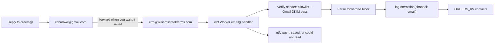

# Forward emails into the admin CRM

Set up `crm@williamscreekfarms.com` through Cloudflare Email Routing. Emails you forward from Gmail (`cchadww@gmail.com`) are logged automatically as Email interactions on the matching admin contact. When there is no match, a new contact is created. You also get an ntfy push with a link to the contact.

Also route `orders@williamscreekfarms.com` to Gmail, so replies to order and hunt emails stop going nowhere. Those replies are not logged automatically. Forward one to `crm@` when you want it saved.

## How it works

## DNS facts (checked Nov 21, 2026)

- The domain is on Cloudflare DNS and has no MX records, so no address on it receives mail today. Enabling Email Routing adds the first MX records and interrupts nothing.
- Resend's SPF record (`include:amazonses.com`) and its MX live on `send.williamscreekfarms.com`, not on the root domain. The root SPF record that Email Routing adds does not need to be merged with Resend's. Leave the `resend._domainkey` DKIM record alone.
- `williamscreekfarms.com` has no DMARC record. That is fine for now and out of scope.

## Pieces

### 1. Email handler on the main `wcf` Worker

The installed `@astrojs/cloudflare` (12.6.13) supports `workerEntryPoint`. So the `email()` handler can live on the same Worker that serves the site:

- Add `src/worker.ts`. It wraps the adapter's default `fetch` export and adds `email(message, env, ctx)`.
- In [astro.config.mjs](../astro.config.mjs), set `adapter: cloudflare({ workerEntryPoint: { path: 'src/worker.ts' } })`.
- The handler writes to `env.ORDERS_KV` directly. That means no public endpoint, no shared secret, and no second Worker. One `npm run deploy` ships it.
- Check that the site still builds and serves normally after the entrypoint change. A Playwright smoke run is enough.
- Fallback: if the custom entrypoint breaks the build, use a small `workers/crm-email-worker` bound to the same `ORDERS_KV` namespace id. It imports `src/lib/inbound-email.ts` so the logic isn't duplicated.

### 2. Sender verification

The gmail.com DMARC policy is `p=none`, so a forged `From: cchadww@gmail.com` is not rejected upstream. Checking `message.from` alone is not enough.

- The allowlist defaults to `cchadww@gmail.com` and can be overridden with `INBOUND_EMAIL_ALLOWLIST` (comma-separated).
- The handler also requires the `Authentication-Results` header that Cloudflare adds to show `dkim=pass` with `header.d=gmail.com`, or the matching domain for any other allowlisted address.
- When either check fails, the handler calls `message.setReject("Not accepted")`. Nothing is stored, and no ntfy push is sent, so strangers can't trigger notifications.

### 3. Parser: `src/lib/inbound-email.ts`

- Add the `postal-mime` dependency to parse MIME. It works in Workers.
- `parseForwardedEmail(raw)` returns `{ forwarder, original: { name, email, date, subject }, note, body, messageId }`:
  - Gmail is the main format: `---------- Forwarded message ---------`, followed by `From:`, `Date:`, `Subject:`, and `To:` lines. `From:` can be `Name <addr>` or a bare address.
  - Apple Mail (`Begin forwarded message:`) and Outlook (`From: ... Sent: ...`) blocks are handled too, since it costs little.
  - Any text you typed above the forward line becomes `note`.
  - `body` is the original message text below the header block. It falls back to the HTML converted to text when there is no plain-text part. Quoted older replies (`On ... wrote:`) are dropped.
  - If there is no forwarded block (for example, you BCC'd `crm@` on a reply), it uses the first `To:` recipient that is not on the allowlist.
- It never creates or matches a contact for an allowlisted address. If the parser can't find someone other than you, it does not log anything. Instead it sends a "could not read" push.
- `nameParts(name, email)` splits the display name into first and last. A single name ("Jeff") becomes the first name with last name `—`. With no display name, it uses the email's local part as the first name and `—` as the last. You can fix either on the contact page.

### 4. Ingest: `ingestInboundEmail(kv, raw, env)` in the same file

- It skips repeats: a KV key `inbound_email_<messageId>` with a 30-day TTL means a Cloudflare retry or a double forward doesn't log twice.
- It calls `logInteraction(kv, { firstName, lastName, email, channel: 'email', summary, at: originalDate })` in [src/lib/contacts.ts](../src/lib/contacts.ts) with no `contactId`, so the existing email-index lookup links the sender's email to their contact when they already have one. Same rules as today: a saved name, phone, or email is never overwritten.
- The summary reads `Subject: ...`, then your note when present (`Note: ...`), then the body. It's trimmed to fit the 4000-character `MAX_SUMMARY`.
- It sends a push on the existing `hedge-order` ntfy topic through `publishNtfyNotification` in [src/lib/ntfy.ts](../src/lib/ntfy.ts). On success the push reads like "Email logged: Jeff Smith — Subject" and opens `/admin/contacts/<id>`. On a parse failure it reads "Couldn't read forwarded email: <subject>".
- Add `INBOUND_EMAIL_ALLOWLIST` to [src/env.d.ts](../src/env.d.ts) and [.env.example](../.env.example).
- Walk-in orders, the contact form, and the manual Email log stay as they are.

### 5. Tests

- `tests/unit/lib/inbound-email.test.ts` covers forward fixtures:
  - Gmail with a name and address, Gmail with a bare address, a note above the forward line, HTML-only mail, and a one-word name.
  - One Apple Mail fixture and one Outlook fixture.
  - The BCC fallback.
  - A forward where the only address found is yours. Nothing is logged, and a failure push is sent.
- Ingest and handler tests cover:
  - Rejecting a sender that isn't on the allowlist.
  - Rejecting an allowlisted `From` without Gmail DKIM pass.
  - Creating a new contact, matching an existing contact by email, and skipping a duplicate Message-ID.

## One-time setup in the Cloudflare dashboard

The wrangler login on this machine can deploy `wcf`, but its token cannot edit DNS or Email Routing. You do these steps yourself after the deploy:

1. Run `npm run deploy`.
2. Go to williamscreekfarms.com, then Email, then Email Routing, and enable it. This adds the MX records and a root SPF record. No merge with Resend is needed (see DNS facts above).
3. Add `cchadww@gmail.com` as a destination address and click the confirmation link Cloudflare sends to that Gmail.
4. Route `orders@williamscreekfarms.com` to the `cchadww@gmail.com` destination.
5. Route `crm@williamscreekfarms.com` with the action "Send to Worker", pointing at `wcf`. Leave catch-all off.
6. Test. Forward Jeff's message to `crm@` from Gmail. He should appear under Admin, then Contacts, with an Email interaction, and you should get the ntfy push. A reply sent straight to `orders@` should land in Gmail and should not create a contact.

Optional later: a Gmail filter can auto-forward certain senders or labels to `crm@`.

## Tasks

- [x] Add `src/worker.ts` with an `email()` handler and wire `workerEntryPoint` in `astro.config.mjs`; confirm the site still builds and serves (fallback: separate worker on the same KV)
- [x] Sender verification: allowlist (default `cchadww@gmail.com`) plus a Gmail DKIM-pass check on `Authentication-Results`; reject everything else silently
- [x] Add `postal-mime` and `src/lib/inbound-email.ts`: Gmail, Apple Mail, and Outlook forwarded blocks, note, body, name split, BCC fallback, and a guard against logging yourself
- [x] Ingest: dedupe (a fingerprint of sender, date, subject, and body, which covers both retries and double forwards), `logInteraction` with the email channel, success and failure ntfy pushes, env typings
- [x] Unit tests for the parser fixtures, sender rejection, dedupe, and contact matching
- [x] Dashboard setup (Email Routing, Gmail destination, `orders@` and `crm@` routes), done Nov 21, 2026
- [ ] End-to-end test with Jeff's email
